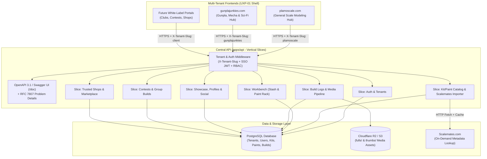

# ESD: PlamoScale & GunplaJunkies Multi-Tenant Scale Modeling Platform

## Document Control

- `[MANDATORY]` Project: Gunpla & PlamoScale Multi-Tenant Scale Modeling Platform (`GUNPLA`)
- `[MANDATORY]` Version: v1.0
- `[MANDATORY]` Owner: Roberto Pineda (`x-codec` / `rpineda@x-codec.net`)
- `[MANDATORY]` Status: Approved for EVT / Ready for DVT Gate
- `[MANDATORY]` Last Updated: 2026-10-23
- `[MANDATORY]` Related PRD: [PRD_GUNPLA_v1.md](file:///Users/rpineda/Sources/Gunpla/docs/cgr/PRD_GUNPLA_v1.md)

---

## Architecture Overview

- `[MANDATORY]` **System context and boundaries:**
  The system is a **Full-Stack TypeScript Monorepo** organized around **Vertical Slice Architecture** (`features/*`). A single central REST API (`apps/api`) serves multiple specialized web frontends (`apps/plamoscale-web` for general scale modeling, `apps/gunplajunkies-web` for Gunpla/Mecha/Sci-Fi, and future B2B white-label club/shop portals) over HTTPS. Relational data is stored in **PostgreSQL**, and binary media assets (build step photos, boxart, thumbnails) are stored in **S3-compatible Object Storage (Cloudflare R2)** with a local filesystem adapter for offline development.
- `[MANDATORY]` **Component topology:**
  - `apps/api`: Node.js + Fastify/Express TypeScript API server with OpenAPI 3.1 auto-generation (`/openapi.json`, `/doc`), JWT SSO authentication, multi-tenant context resolution (`X-Tenant-Slug` / `Host`), and vertical feature slices:
    - `src/slices/tenants` (FR1)
    - `src/slices/auth-sso` (FR2)
    - `src/slices/catalog-scalemates` (FR3)
    - `src/slices/workbench-stash` (FR4)
    - `src/slices/build-logs` (FR5)
    - `src/slices/media-storage` (FR7)
    - `src/slices/showcase-social` (FR6, FR9)
    - `src/slices/contests-clubs` (FR10)
    - `src/slices/shops-marketplace` (FR11)
  - `apps/plamoscale-web`: Responsive web frontend for `plamoscale.com` implementing `UXP-01 Modern App Shell Layout` with general scale modeling taxonomy (`All`, `Military`, `Aviation`, `Automotive`, `Gunpla & Mecha`, `Figures`, `Dioramas`, `Naval`) and community institutional sections.
  - `apps/gunplajunkies-web`: Responsive web frontend for `gunplajunkies.com` implementing `UXP-01 Modern App Shell Layout` with Mecha/Sci-Fi dark-mode cyber aesthetics and Gunpla grade taxonomy (`HG`, `RG`, `MG`, `PG`, `SD`, `30MM`, `Kotobukiya`, `Custom/Kitbash`).
  - `packages/shared`: Shared TypeScript DTOs, Zod/TypeBox validation schemas, OpenAPI client types, and `UXP-01` design system primitives.
- `[MANDATORY]` **Data flow narrative:**
  1. A user accesses `plamoscale.com` or `gunplajunkies.com`.
  2. The frontend sends API requests to `/api/v1/*` including `X-Tenant-Slug: plamoscale` (or `gunplajunkies`) and an optional `Authorization: Bearer <jwt>` (or `httpOnly` SSO cookie).
  3. The API Tenant Middleware resolves the tenant configuration and applies automatic category scoping when listing public builds, contests, or shops.
  4. When a builder uploads WIP or final photos (`POST /api/v1/media/upload`), the API validates MIME/magic bytes, generates a `400px` WebP thumbnail (`thumbs/`) and `1920px` WebP full image (`fulls/`), uploads both to Cloudflare R2 (or local storage in dev), and persists the metadata in PostgreSQL.
- `[CONDITIONAL]` **Architecture diagram reference:**



---

## Data Model

- `[MANDATORY]` **Key entities:**
  1. `tenants`: `id (UUID PK)`, `slug (unique: 'plamoscale', 'gunplajunkies', ...)`, `name`, `domain`, `theme_config (JSONB)`, `allowed_categories (TEXT[])`, `created_at`.
  2. `users`: `id (UUID PK)`, `username (unique)`, `display_name`, `email (unique)`, `password_hash`, `bio`, `avatar_url`, `social_links (JSONB: instagram, tiktok, facebook, youtube, scalemates)`, `primary_tenant_id (FK)`, `created_at`.
  3. `roles` & `user_roles`: `user`, `moderator`, `tenant_admin`, `admin` (evolves legacy `gunplajunkies.com/app/models/role.model.js`).
  4. `brands`: `id`, `name` (e.g., Bandai Spirits, Tamiya, Hasegawa, Kotobukiya, Eduard, Vallejo, Mr. Hobby), `type` (`kit`, `paint`, `tool`, `both`), `country`.
  5. `scale_kits`: `id (UUID PK)`, `brand_id (FK)`, `name`, `kit_number`, `scale` (e.g., `1/144`, `1/100`, `1/60`, `1/35`, `1/48`, `1/72`), `category` (`gunpla-mecha`, `military`, `aviation`, `automotive`, `naval`, `figures`, `scifi`, `diorama`), `grade` (e.g., `HG`, `RG`, `MG`, `PG`, `Standard`), `release_year`, `boxart_url`, `manual_url`, `scalemates_url (unique nullable)`, `barcode_ean`, `created_by (FK)`.
  6. `paints`: `id (UUID PK)`, `brand_id (FK)`, `code` (e.g., `C-01`, `XF-1`, `70.950`), `name`, `color_hex`, `paint_type` (`lacquer`, `acrylic`, `enamel`, `oil`, `primer`, `topcoat`, `weathering`), `finish` (`gloss`, `semi-gloss`, `matte`, `metallic`, `pearl`).
  7. `stash_items`: `id (UUID PK)`, `user_id (FK)`, `kit_id (FK)`, `status` (`unbuilt`, `in_progress`, `built`, `wishlist`, `for_trade`), `quantity`, `notes`, `acquired_at`.
  8. `user_paints`: `id (UUID PK)`, `user_id (FK)`, `paint_id (FK)`, `status` (`owned`, `low_stock`, `wishlist`), `quantity`.
  9. `build_projects`: `id (UUID PK)`, `user_id (FK)`, `kit_id (FK nullable)`, `title`, `slug`, `status` (`wip`, `completed`, `archived`), `category`, `scale`, `summary`, `cover_media_id (FK)`, `is_featured (BOOLEAN)`, `views_count`, `likes_count`, `published_tenants (TEXT[])`, `created_at`, `updated_at`.
  10. `build_steps`: `id (UUID PK)`, `build_id (FK)`, `step_number`, `stage_type` (`unboxing`, `assembly`, `modification`, `priming`, `painting`, `decals`, `weathering`, `final_reveal`), `title`, `content_markdown`, `created_at`.
  11. `build_step_paints`: `build_step_id (FK)`, `paint_id (FK)`, `usage_note` (e.g., "Base coat 70% + 30% leveling thinner").
  12. `media_assets`: `id (UUID PK)`, `user_id (FK)`, `build_id (FK nullable)`, `build_step_id (FK nullable)`, `thumb_url`, `full_url`, `width`, `height`, `size_bytes`, `mime_type`, `alt_text`, `legacy_source_path`, `created_at`.
  13. `likes` & `comments`: Social interactions on `build_projects` with moderation status (`visible`, `hidden`, `flagged`).
  14. `contests` & `contest_entries`: Tenant-scoped competitions (`tenant_id`, `title`, `rules_markdown`, `start_date`, `end_date`, `status`) and submitted `build_id` entries with judge scores.
  15. `trusted_shops` & `marketplace_listings`: Verified stores (`name`, `country`, `city`, `website_url`, `whatsapp_url`, `catalog_url`, `is_verified`) and user commission/kit trade listings.
- `[MANDATORY]` **Relationships and lifecycle:**
  - `users` 1:N `build_projects` 1:N `build_steps` 1:N `media_assets`.
  - `scale_kits` 1:N `build_projects` and 1:N `stash_items`.
  - Deleting a `build_project` soft-deletes the database record (`status = 'archived'`) and schedules R2 media cleanup after a 30-day recovery window.
- `[MANDATORY]` **Storage locations:**
  - Primary transactional store: PostgreSQL 16+ on `x-codec` VPS (with automated fallback to file-backed SQLite/JSON store for zero-config local CLI smoketests when PostgreSQL is not running).
  - Binary object store: Cloudflare R2 bucket (`plamoscale-media`) via S3 API, with local `/public/uploads/` fallback for offline dev and seed verification.

---

## API Contracts

- `[CONDITIONAL]` **External APIs used:**
  1. **Scalemates Web Metadata Connector:** Performs rate-limited, cached HTTP `GET` requests when a builder submits a Scalemates URL (e.g., `https://www.scalemates.com/kits/...`), parsing OpenGraph, JSON-LD, and structured kit fields (`brand`, `scale`, `kit_number`, `year`, `boxart`).
  2. **Cloudflare R2 (S3 REST API):** Pre-signed `PUT` or server-side `PutObjectCommand` for uploading `thumbs/` and `fulls/`.
  3. **Mailchimp Form Action:** Preserves subscription integration (`plamoscale.us14.list-manage.com/subscribe/post`).
- `[MANDATORY]` **Auth and authorization model:**
  - Stateless **JWT (`HS256`)** issued on `POST /api/v1/auth/signin` and `POST /api/v1/auth/signup`, accepted via `Authorization: Bearer <token>` header or `httpOnly` cookie (`plamo_sso_token`), enabling single sign-on across `plamoscale.com`, `gunplajunkies.com`, and future client frontends.
  - Role guards: `requireAuth`, `requireRole(['moderator', 'admin'])`, `requireTenantAdmin`.
- `[MANDATORY]` **Error handling approach:**
  All 4xx and 5xx responses conform to **IETF RFC 7807 Problem Details (`application/problem+json`)**:
  ```json
  {
    "type": "https://api.plamoscale.com/problems/validation-error",
    "title": "Invalid request parameters",
    "status": 400,
    "detail": "Field 'scale' must match standard ratio format (e.g. 1/144, 1/35).",
    "instance": "/api/v1/catalog/kits"
  }
  ```
- `[CONDITIONAL]` **Rate limits and throttling behavior:**
  - Global rate limit: `120 req/min` per IP (`429 Too Many Requests` with `Retry-After` header).
  - Auth & Scalemates import endpoints: `15 req/min` per IP.

---

## Infrastructure And Environments

- `[MANDATORY]` **Development (`local`):**
  - Developer laptop (macOS/Linux/Windows) running Node.js 20+ LTS, TypeScript monorepo workspaces, local PostgreSQL (or embedded SQLite/file DB fallback for instant CLI smoketests), and local media directory serving the 92 seed photos from `docs/reference/preexisting-root/plamoscale.com/images/`.
  - Ports: API on `http://localhost:8080` (Swagger at `http://localhost:8080/doc`), `plamoscale.com` front on `http://localhost:3001`, `gunplajunkies.com` front on `http://localhost:3002`.
- `[MANDATORY]` **Test (`staging` / CI):**
  - GitHub Actions runner + staging subdomain on `x-codec` VPS executing automated unit tests, integration tests, OpenAPI schema validation, and `scripts/smoketest.ps1` / `npm test`.
- `[MANDATORY]` **Production (`prod`):**
  - `x-codec` VPS / Hosting (`Docker` or `cPanel / Phusion Passenger` Node.js process manager using `tmp/restart.txt` compatibility as seen in legacy `gunplajunkies.com`) + managed/VPS PostgreSQL + Cloudflare DNS/CDN + Cloudflare R2 object storage.
- `[OPTIONAL]` **Environment parity notes:** Environment variables (`.env.example` vs `.env`) strictly control DB connection, JWT secret, R2 credentials, and allowed CORS tenant origins without code changes between environments.

---

## Vendor Selection Rationale

- `[CONDITIONAL]` **Selected vendor or platform:**
  1. **Compute & DB Hosting:** `x-codec` existing VPS / Hosting infrastructure + PostgreSQL.
  2. **Object Storage & CDN:** Cloudflare R2 + Cloudflare CDN.
  3. **Source Control & CI/CD:** GitHub (`rpinedaec83/Gunpla`).
- `[CONDITIONAL]` **Alternatives considered:**
  - *Alternative A — Full Hyperscaler Serverless (Azure Functions / AWS Lambda + Managed RDS):* Rejected for v1 because `x-codec` already operates paid VPS/hosting capacity (`gunplajunkies.com` / `plamoscale.com`), and serverless cold starts + NAT/egress fees increase monthly fixed costs.
  - *Alternative B — Storing images directly on VPS disk (status quo in `plamoscale.com`):* Rejected for user-generated uploads because high-resolution model photography will quickly exhaust VPS disk quotas; Cloudflare R2 provides 10 GB free/month and $0 egress bandwidth fees.
- `[CONDITIONAL]` **Approval status:** Approved by Roberto Pineda (`x-codec` Executive Sponsor & Business Owner) on 2026-10-23.

---

## Monitoring And Alerting

- `[MANDATORY]` **Monitoring tools and dashboards:**
  - Active health endpoint: `GET /api/v1/health` reporting `{ status: "ok", uptime, db: "connected", storage: "ready", tenantsCount, seededPhotosCount }`.
  - Structured JSON logs via `pino` / standard stdout captured by VPS process supervisor (`pm2` / Docker / Passenger log rotation).
  - External uptime monitor (Cloudflare Health Checks / UptimeRobot) polling `GET /api/v1/health`, `https://plamoscale.com`, and `https://gunplajunkies.com` every 60 seconds.
- `[MANDATORY]` **Alert thresholds and ownership:**
  - **Critical Alert (Email/WhatsApp to Roberto Pineda):** `/api/v1/health` returns non-200 for 2 consecutive checks (2 minutes), or 5xx error rate exceeds 2% over 5 minutes.
  - **Warning Alert:** API p95 latency > 500 ms or VPS disk usage > 80%.
- `[CONDITIONAL]` **Approved exception details:** Instead of enterprise APM agents (Datadog/NewRelic) which add licensing cost, v1 uses lightweight OpenAPI health probes + structured JSON logging + Cloudflare analytics, approved by Platform Owner Roberto Pineda.

---

## Deployment And Configuration

- `[MANDATORY]` **Deployment pipeline path:**
  1. Developer + AI Pair Programmer complete a Vertical Slice Devtask (`DT`) locally.
  2. Run `npm run test` and `npm run smoketest` (verifying API endpoints, OpenAPI `/doc`, and UI build).
  3. Commit and push to `https://github.com/rpinedaec83/Gunpla`.
  4. GitHub Actions CI validates build, lint, tests, and OpenAPI contract.
  5. Production deployment pulls the verified release tag on `x-codec` VPS, runs `npm run build` and `npm run db:migrate`, and triggers zero-downtime reload (`pm2 reload` / `touch tmp/restart.txt`).
- `[MANDATORY]` **Configuration source of truth:**
  - Non-secret infrastructure bindings: committed [`accounts.md`](file:///Users/rpineda/Sources/Gunpla/accounts.md).
  - Runtime environment template: committed `.env.example`.
  - Secrets: local-only [`secrets.md`](file:///Users/rpineda/Sources/Gunpla/secrets.md) (git-ignored) and production VPS environment variables.
- `[MANDATORY]` **Manual step exceptions and retirement plan:**
  - Initial creation of the production PostgreSQL database and Cloudflare R2 bucket is a one-time setup step performed by Roberto Pineda prior to DVT deployment; all subsequent schema migrations and seed runs are 100% automated via `npm run db:migrate` and `npm run db:seed`.

---

## Security And Credential Handling

- `[MANDATORY]` **Access control model:**
  - **RBAC (`user`, `moderator`, `tenant_admin`, `admin`)** enforced at the API middleware layer.
  - **Resource Ownership Enforcement:** Only the author of a `BuildProject`, `StashItem`, or `UserPaint` (or an `admin`/`moderator`) can modify or delete it.
  - **Tenant Isolation:** CORS and `X-Tenant-Slug` middleware validate that requests originate from registered tenant domains.
- `[MANDATORY]` **MFA and privileged access controls:**
  - GitHub (`rpinedaec83`), Cloudflare, and `x-codec` VPS root/cPanel access require MFA and are restricted exclusively to Roberto Pineda.
  - Production database listens only on `127.0.0.1` / private Docker network (not exposed to the public internet).
- `[MANDATORY]` **Secrets handling and rotation:**
  - Zero credentials in source code or git history (validated by `atlas-validate.ps1` checking that `secrets.md` and `.env` are untracked).
  - `JWT_SECRET` (minimum 256-bit random key) and `R2_SECRET_ACCESS_KEY` rotated every 180 days or immediately upon suspected compromise.
- `[MANDATORY]` **Security review status:**
  - Baseline NIST CSF 2.0 & OWASP Top 10 controls designed into architecture (bcrypt password hashing, parameterized SQL queries preventing SQLi, Zod input sanitization preventing XSS, magic-byte image verification preventing malicious file uploads). Formal pre-production security sign-off scheduled at DVT -> PVT gate by Security Owner Roberto Pineda.

---

## Capacity Planning

- `[MANDATORY]` **Expected user volume:**
  - DVT Pilot: 4–20 concurrent builders.
  - Year 1 GA: 2,000 registered builders, 15,000 monthly active visitors across `plamoscale.com` and `gunplajunkies.com`.
- `[MANDATORY]` **Throughput assumptions:**
  - Normal read load: 5–20 req/sec.
  - Peak contest/showcase load: 100 req/sec.
  - Photo upload throughput: up to 10 concurrent image uploads (capped at 15 MB per file).
- `[MANDATORY]` **Capacity limits and bottlenecks:**
  - **Bottleneck 1 — Image Processing CPU/Memory:** Resizing high-res JPG/PNG images on the VPS can spike RAM. *Mitigation:* Enforce a bounded concurrency queue (max 2 simultaneous `sharp` transforms) and stream directly to Cloudflare R2.
  - **Bottleneck 2 — PostgreSQL Connection Pool:** *Mitigation:* Configure connection pool (`max: 10, min: 2, idle: 10000` ms) with indexed queries on `(tenant_slug, category, status, created_at)`.
- `[MANDATORY]` **Validation method:**
  - Automated smoketest and load check verifying 50 concurrent `GET /api/v1/builds` and `GET /api/v1/catalog/kits` requests complete with p95 < 250 ms and 0% errors.

---

## Rollback Plan

- `[MANDATORY]` **Go-back conditions:**
  - Unhandled HTTP 5xx rate > 2% for 15 minutes after deployment.
  - Failure of `/api/v1/health` or broken SSO login across `plamoscale.com` / `gunplajunkies.com`.
  - Missing or corrupted legacy builder gallery photos (`aperich`, `dcampos`, `cluna`, `fog1labs1`).
- `[MANDATORY]` **Rollback steps:**
  1. **Application Rollback (< 3 minutes):** Checkout previous verified git tag (`git checkout v1.x-prev`), rebuild/restart service (`pm2 reload` or `touch tmp/restart.txt`).
  2. **Static Emergency Fallback (< 2 minutes):** Because the original `plamoscale.com` static HTML/JS and `gunplajunkies.com` files are preserved intact under `docs/reference/preexisting-root/`, the web root can immediately point back to the static snapshot if a critical platform incident occurs during initial cutover.
  3. **Database Rollback:** Restore pre-deployment PostgreSQL snapshot (`pg_restore`) if a destructive schema change occurred (all migrations in v1 are strictly additive/backward-compatible).
- `[MANDATORY]` **Data impact and mitigation:**
  - Pre-deployment automated `pg_dump` runs before any schema migration so RPO (Recovery Point Objective) is < 5 minutes and RTO (Recovery Time Objective) is < 10 minutes.
- `[MANDATORY]` **Authorization owner:** Roberto Pineda (`x-codec` Platform & Product Owner).

---

## Pilot Plan

- `[MANDATORY]` **Pilot audience and scope:**
  - **Audience:** Roberto Pineda + the 4 founding builders from `plamoscale.com`: Aldo Perich (`aperich`), Daniel Campos (`dcampos`), Cristhian Luna (`cluna`), and Fernando Garaicoa (`fog1labs1`).
  - **Scope:** Full verification of migrated portfolios (~92 photos), SSO login across `plamoscale.com` and `gunplajunkies.com`, Scalemates kit import, Stash & Paint Rack management, and publishing a new multi-step Build Log.
- `[MANDATORY]` **Pilot duration:** 7–14 days during DVT stage.
- `[MANDATORY]` **Acceptance criteria mapping:**
  - Maps directly to PRD `SM1` (100% legacy migration), `SM2` (Multi-tenant SSO across both fronts), `SM3` (<5 min build log publication), and `SM4` (4/4 founding builder approval).

---

## Operational Handoff

- `[MANDATORY]` **Support owner:** Roberto Pineda (`x-codec` / `rpineda@x-codec.net`).
- `[MANDATORY]` **Runbook and dashboard references:**
  - Operational commands standardized across the monorepo:
    - `npm install`: Install all workspace dependencies.
    - `npm run db:seed`: Idempotently seed tenants (`plamoscale`, `gunplajunkies`), roles, sample Gunpla/scale kits, paints, trusted shops, and all 4 founding builders + ~92 legacy photos.
    - `npm run dev`: Start API (`:8080`) and frontends (`:3001`, `:3002`).
    - `npm run smoketest`: Execute end-to-end health, OpenAPI, tenant resolution, catalog, stash, and build-log verification.
  - Interactive API documentation & live tester: `/doc` (Swagger UI) and `/openapi.json`.
- `[MANDATORY]` **Escalation path and support hours:**
  - Tier 1 (Community Moderation): Moderators (`moderator` role) handle content/comment flags daily (`09:00–21:00 PET / UTC-5`).
  - Tier 2/3 (Platform & Infrastructure Engineering): Roberto Pineda (`x-codec`), on-call 24/7 for critical production outages (`P0` response < 2 hours).

---

## Vendor Support Agreement

- `[CONDITIONAL]` **Support tier:**
  - **x-codec Hosting / VPS:** Managed by `x-codec` infrastructure team with standard hosting provider hardware SLA (99.9%).
  - **Cloudflare (DNS, CDN, R2 Object Storage):** Cloudflare Standard Plan with global status monitoring (`cloudflarestatus.com`).
  - **Open-Source Runtime (Node.js LTS, TypeScript, PostgreSQL):** Community LTS support with automated `npm audit` security patching.
- `[CONDITIONAL]` **SLA and response expectations:** Target platform availability 99.5% monthly; critical infrastructure restoration < 4 hours.
- `[CONDITIONAL]` **Engineering escalation path:** Direct escalation to Roberto Pineda (`rpineda@x-codec.net`), who holds full administrative control over DNS, VPS, database, and GitHub repository.

---

## Ownership And Gate Approvals

- `[MANDATORY]` **Product Owner:** Roberto Pineda (`x-codec`) — Approved
- `[MANDATORY]` **Business or Commercial Owner:** Roberto Pineda (`x-codec`) — Approved
- `[MANDATORY]` **IT or Platform Owner:** Roberto Pineda (`x-codec`) — Approved
- `[MANDATORY]` **Security or Compliance:** Roberto Pineda (`x-codec`) — Approved

| Gate | Required Signers | Status | Date |
|---|---|---|---|
| **EVT Entry Gate** | Executive Sponsor, Product Owner, Business Owner (Roberto Pineda) | **Approved** | 2026-10-23 |
| **EVT -> DVT Gate** | EVT Signers + IT/Platform Owner + Security Owner (Roberto Pineda) | **Ready upon Vertical Slices 1–5 Smoketest** | Target: Devcycle 1–2 |
| **DVT -> PVT Gate** | All Owners + 4 Pilot UAT Builders Sign-off | Pending DVT Pilot | Target: Post-Pilot |

---

## Post Go-Live Review

- `[MANDATORY]` **Review date window:** Within 7 calendar days after Production GA cutover of `plamoscale.com` and `gunplajunkies.com`.
- `[MANDATORY]` **Metrics to evaluate:**
  1. API uptime and p95 response latency (< 250 ms target).
  2. Unhandled 5xx error count and Scalemates import success rate.
  3. Cloudflare R2 storage consumption and thumbnail cache hit ratio.
  4. Builder sign-ups, new build logs published, and community feedback tickets in the first 7 days.
- `[MANDATORY]` **Review owner:** Roberto Pineda (`x-codec`).

---

## Customer Responsibility Matrix

- `[CONDITIONAL]` **Customer-hosted applicability:** **Not applicable (`SaaS / x-codec Managed Platform`)**. Neither end-user builders nor B2B white-label club/shop tenants host their own backend infrastructure; `x-codec` operates the central API, database, object storage, and frontend deployments.
- `[CONDITIONAL]` **Responsibility split and acceptance record:**
  - `x-codec` (Platform Provider): 100% responsible for infrastructure, backups, security patching, API uptime, and SSL certificates.
  - B2B White-Label Tenant Admin (when custom domain is used): Responsible only for pointing a single DNS `CNAME` record to `x-codec` and moderating their club's contest rules.

---

## Supportability And SOP

- `[MANDATORY]` **SOP and runbook references:**
  - **SOP-01 (Adding a New White-Label Client / Tenant):** Insert tenant record via `POST /api/v1/tenants` (or seed config) with `slug`, `name`, `domain`, `theme_config`, and `allowed_categories`. No backend redeploy required.
  - **SOP-02 (Legacy Seed & Data Recovery):** Run `npm run db:seed` to verify and populate the 4 founding builders (`aperich`, `dcampos`, `cluna`, `fog1labs1`) and ~92 photos from `docs/reference/preexisting-root/plamoscale.com/`.
  - **SOP-03 (Database Backup & Restore):** Daily cron executes `pg_dump -Fc gunpla_prod > backup_$(date +%F).dump` and uploads encrypted archive to a separate R2 backup prefix with 30-day retention.
- `[MANDATORY]` **On-call and incident model:**
  - Automated health checks alert Roberto Pineda (`rpineda@x-codec.net`).
  - Incident triage follows severity levels: `SEV-1` (Complete outage / auth broken — immediate rollback or fix within 2h), `SEV-2` (Single slice degraded, e.g., Scalemates external import slow — graceful fallback to manual entry, fix within 24h), `SEV-3` (UI cosmetic issue — scheduled as next `RDT` or `DT` in `docs/agile/devcycle.md`).

---

## Platform Constraints

- `[MANDATORY]` **Known constraints:**
  1. **Shared VPS Memory & CPU Ceiling:** Running Node.js + image manipulation on a single VPS can saturate CPU if dozens of users upload 15 MB RAW photos simultaneously.
  2. **Scalemates External HTML Structure Changes:** Because Scalemates does not offer a public commercial SLA API, its HTML layout may change over time.
- `[MANDATORY]` **Constraint mitigation strategy (No Masking Policy — Rule 5):**
  1. We do **not** mask VPS memory/disk limits with unbounded in-memory queues; instead, upload endpoints enforce strict file-size caps (15 MB), bounded worker concurrency (2), HTTP `429` backpressure when busy, and offload storage to Cloudflare R2.
  2. We do **not** hide Scalemates parser failures behind silent retries; if an external Scalemates URL cannot be parsed within 4 seconds, the API returns a transparent status with partial/extracted fields and immediately enables manual kit entry so the builder is never blocked.

---

## Pre-Review Checklist -- ESD

- [x] Architecture model is complete and linked.
- [x] PRD requirements map to architecture and API contracts.
- [x] Security controls and review status are explicit.
- [x] Monitoring, alerting, and handoff ownership are defined.
- [x] Capacity and rollback sections have executable validation details.
- [x] Pilot criteria can verify PRD acceptance criteria.
- [x] No mandatory field remains unresolved.
- [x] ESD is ready for DVT gate review.
